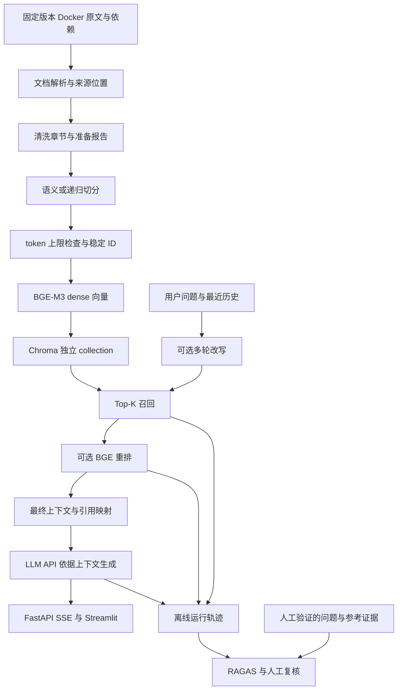

# 架构与实验边界

解析层不加载模型；服务启动不自动创建空知识库、不在导入时调用 LLM。
索引保存处理配置指纹与 ready/failed 状态，阻止不同切分/模型混用。
来源依据为原文 URL 与章节行号；include 内容保留独立来源，功能版本条件来自同 commit 的元数据。
重排无法补回召回阶段遗漏的证据；context 相关不代表答案正确，生成和检索分开评价。

当前范围是 dense 检索、cross-encoder 重排与文档问答。权限隔离、混合检索、OCR、模型微调、生产并发不在当前已完成能力中。
